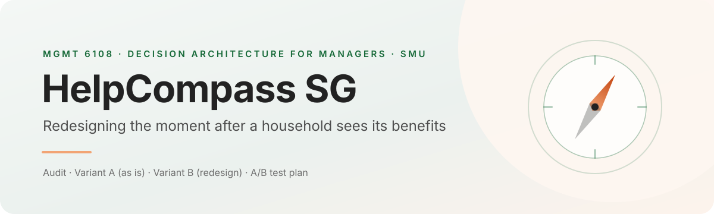

<p align="center">
  
</p>

<p align="center">
  <a href="https://support-go-where-singapore.vercel.app/"><b>Live prototype</b></a>
  &nbsp;·&nbsp;
  <a href="AUDIT.md"><b>Audit</b></a>
  &nbsp;·&nbsp;
  <a href="PROMPTS.md"><b>Prompt log</b></a>
  &nbsp;·&nbsp;
  <a href="audit/screenshots/SHOTLIST.md"><b>Dated screenshots</b></a>
</p>

---

**HelpCompass SG** is a class prototype that rebuilds one screen of Singapore's public benefits portal, the results page of its benefits calculator, and redesigns the single decision that page shapes: what a household does once it has seen what it may receive.

The brand, scheme names and household data in the prototype are fictional. Nothing in it collects personal data, takes a payment or submits an application.

## The decision

> When a household that has just run the calculator decides what to do about its results, the screen steers it toward reading one large total and leaving without a next step.

We audited the live page before designing anything. The audit is committed ahead of any work on the redesign, so its predictions cannot bend to fit the result.

## What the audit found

| | |
|:--|:--|
| **What already works** | The page leads with an honest, hedged total ("Up to $8,450 and 2.5 months of rebate" for our main persona). The redesign keeps it. |
| **The central problem** | All 10 schemes our persona receives are officially "no application needed", yet three still need the household to act: claim vouchers, open an app, or sign up once. On screen they look exactly like the automatic ones. |
| **What is missing** | No prompt to plan, no reminder, and no way to save the results: a reopened results link returns to the start of the calculator. |

Twelve findings in all, each with its principle, the course reading, whose goal wins and a severity rating, and every repair with a prediction that could fail: **[AUDIT.md](AUDIT.md)**.

## The two variants

| Variant | What it is | Status |
|:--|:--|:--|
| **A · as is** | The live results page rebuilt element by element under the fictional brand, checked against dated screenshots | Built · [`src/variantA/`](src/variantA/) |
| **B · redesign** | Every change traces to a finding in the audit: a "Start here" block, plain labels for what arrives by itself and what to claim, a "What you'll need" list, an optional day picker with an equally visible "Skip" | In progress |
| **Test** | One URL, `?v=A` or `?v=B`, with a consent screen before and a debrief screen after | In progress |

## Repository map

```text
AUDIT.md              the audit: 12 findings, severity ratings, predictions
PROMPTS.md            every AI prompt in order, initialled, failures kept
REFLECTION.md         critical thinking and pilot results (after the pilot)
audit/
  evidence/           live calculator results and scheme records, 24 Oct 2026
  screenshots/        17 dated screenshots of the live page, logged in SHOTLIST.md
src/
  variantA/           variant A: the live results page under the fictional brand
  components/         site shell and shared screens
```

## Ground rules we kept

- **Fictional brand, real evidence.** Every claim about the live page can be checked against a dated screenshot or a saved record in `audit/`.
- **Audit before build.** Findings and predictions were committed before the first prompt for variant B.
- **Nudge, not sludge.** Each change in B must serve the household's own goal and be as easy to ignore as to accept.
- **A pilot is a pilot.** Any classroom result is reported as a pilot, not as proof.

---

<sub>MGMT 6108 Decision Architecture for Managers · Prof. Sungjong Roh · Singapore Management University · Term paper, Term 1 AY2026-27. A student prototype, not an official government service.</sub>
