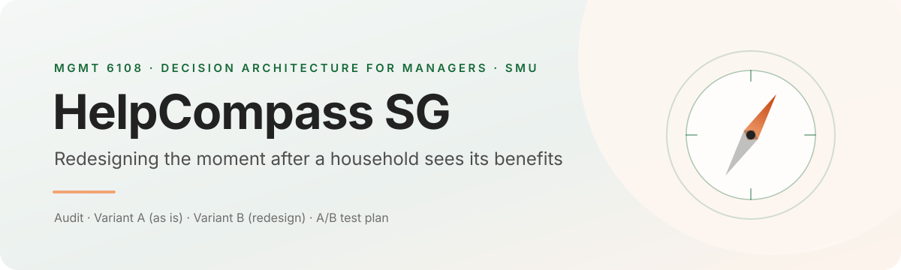

<p align="center">
  
</p>

<p align="center">
  <a href="https://support-go-where-singapore.vercel.app/"><b>Live prototype</b></a>
  &nbsp;·&nbsp;
  <a href="AUDIT.md"><b>Audit</b></a>
  &nbsp;·&nbsp;
  <a href="PROMPTS.md"><b>Prompt log</b></a>
  &nbsp;·&nbsp;
  <a href="DESIGN.md"><b>Design</b></a>
  &nbsp;·&nbsp;
  <a href="audit/screenshots/SHOTLIST.md"><b>Dated screenshots</b></a>
</p>

---

**HelpCompass SG** is a class prototype that rebuilds one screen of Singapore's public benefits portal, the results page of its benefits calculator, and redesigns the single decision that page shapes: what a household does once it has seen what it may receive.

The brand, scheme names and household data in the prototype are fictional. Nothing in it collects personal data, takes a payment or submits an application.

## The decision

> When a household that has just run the calculator decides what to do about its results, the screen steers it toward reading one large total and leaving without a next step.

We audited the live page before designing anything. The audit is committed ahead of any work on the redesign, so its predictions cannot bend to fit the result.

## What the audit found

| Area | What we found |
|:--|:--|
| **What already works** | The page leads with an honest, hedged total ("Up to $8,450 and 2.5 months of rebate" for our main persona). The redesign keeps it. |
| **The central problem** | All 10 schemes our persona receives are officially "no application needed", yet three still need the household to act: claim vouchers, open an app, or sign up once. On screen they look exactly like the automatic ones. |
| **What is missing** | No prompt to plan, no reminder, and no way to save the results: a reopened results link returns to the start of the calculator. |

Twelve findings in all, each with its principle, the course reading, whose goal wins and a severity rating, and every repair with a prediction that could fail: **[AUDIT.md](AUDIT.md)**.

## The two variants

| Variant | What it is | Status |
|:--|:--|:--|
| **A · as is** | The live results page rebuilt element by element under the fictional brand, checked against dated screenshots | Built · [`src/variantA/`](src/variantA/) |
| **B · redesign** | The same screen and data, rebuilt around what the household has to do: a "Start here" to-do list, a plain status on every scheme, paid and still-to-come marks, conditions beside the amounts, a payout calendar, a plan with reminders, and a scripted helper. [What B adds](#what-variant-b-adds) | Built · [`src/variantB/`](src/variantB/) · [each repair checked against the audit](AUDIT.md#added-after-building) · [colours and reasons](DESIGN.md) |
| **Switch** | One URL: `?v=A` or `?v=B` always wins. With no `?v=`, a visitor is assigned A or B at random and keeps it on reload. An on-page toggle lets markers flip between them | Built · [`src/study/`](src/study/) |
| **Test** | A consent screen first and a debrief screen after "I'm finished", the same for A and B. Primary metric, guardrails and sample size | Screens built · [`src/study/`](src/study/) · test plan in the paper, section 4 |

## What variant B adds

Every change traces to a finding in [AUDIT.md](AUDIT.md). Each one can be skipped or ignored, and none hides an option.

| For the visitor | What B shows | Finding |
|:--|:--|:--|
| *Do I have to do anything?* | **Start here**: the 2 or 3 items that need the household, as one to-do list. Each opens to how-to steps, what to have ready, a day picker and Skip, with "I've done this" ticks and a progress count | 4, 5, 7, 10 |
| *Does this arrive by itself?* | A plain status on every scheme: *Automatic: nothing to do*, *Claim it yourself: [where]* or *Automatic if you have signed up before* | 5 |
| *What is this scheme?* | One plain-language line, an icon and a colour for each kind of support | 6, 12 |
| *Is the money already here?* | *Already paid*, *Paid if signed up*, *Ready to claim* or *Still to come* on every row, the total split the same way, and a month-by-month payout calendar | 3, 5 |
| *Is there a catch?* | Each condition, such as an income range, shown next to the amount it limits | 8 |
| *How do I remember?* | **Your plan**: the days picked, calendar reminders, a printable one-page plan, and a message to send to someone who can help | 10, 11 |
| *Can I just ask?* | **Ask Compass**: a scripted helper with fixed answers built from the page's own data. No AI model, no network call | 7, 11 |
| *Can I read it easily?* | A summary that stays in view on wide screens, text size A / A+ / A++, *Listen* (read aloud), calm motion that switches off under reduced-motion settings, and WCAG AA contrast throughout | W7 fluency |

## Repository map

```text
AUDIT.md              the audit: 12 findings, severity ratings, predictions
PROMPTS.md            every AI prompt in order, initialled, failures kept
REFLECTION.md         critical thinking and what we would test next
DESIGN.md             variant B's colours, layout and usability changes, with reasons
audit/
  evidence/           live calculator results and scheme records, 24 Oct 2026, rechecked 1 Nov
  screenshots/        17 dated screenshots of the live page, logged in SHOTLIST.md
src/
  variantA/           variant A: the live results page under the fictional brand
  variantB/           variant B: the same page with our nudges (slots/ holds each part)
  study/              the ?v= switch, random assignment, toggle, consent and debrief
  theme/              colour tokens shared by the site shell and variant B
  components/         site shell and shared screens
```

## Ground rules we kept

- **Fictional brand, real evidence.** Every claim about the live page can be checked against a dated screenshot or a saved record in `audit/`.
- **Audit before build.** Findings and predictions were committed before the first prompt for variant B. Anything learned later is dated under "Added after building".
- **Nudge, not sludge.** Each change in B must serve the household's own goal and be as easy to ignore as to accept.
- **A pilot is a pilot.** Any classroom result is reported as a pilot, not as proof.
- **Readable for everyone.** Text meets WCAG AA contrast, nothing relies on colour alone, and all motion stops for visitors who ask their device for less.

---

<sub>MGMT 6108 Decision Architecture for Managers · Prof. Sungjong Roh · Singapore Management University · Term paper, Term 1 AY2026-27. A student prototype, not an official government service.</sub>
